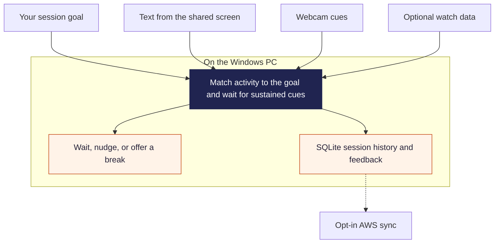

# PomoNoBro | Focus with Context

**Team WeKnowWhatWereDong · wHACKiest 2026 · Track 3 — Know Thyself**

PomoNoBro is a proposed Windows focus timer that uses your session goal to decide when a nudge would help. It keeps apps available so you can move between a lecture, notes and other resources during the same session.

## One 25-minute study session

**Goal** · Study discrete mathematics on YouTube and take notes.

| What happens | How PomoNoBro responds |
| --- | --- |
| You move from the lecture to your notes. | The timer keeps running quietly. |
| You step away for 10 seconds. | It gives you time to come back. |
| You watch a gaming video for 45 seconds. | An ElevenLabs cue asks, “Back to your maths lecture?” |
| Webcam cues suggest drowsiness and recent watch data adds context. | It offers a short break. |

You can snooze a cue or mark **I was on task**. That feedback helps the timer adjust future nudges.

## What drives the decision

The PC processes and discards screen and webcam frames. Watch readings stay on your devices. Optional AWS sync carries session summaries and cue feedback.

## 24-hour MVP

> [!NOTE]
> **Ideathon proposal.** The demo uses live screen and webcam inputs with clearly labeled sample watch data.

- **Build:** Electron and React for the Windows timer. Use local OCR and text matching for screen context, MediaPipe for webcam cues, and cached ElevenLabs audio for offline playback.
- **Verify:** The relevant lecture and brief interruption should pass quietly. A sustained off-task switch should trigger one cue. Track time back on task and user-marked unwanted nudges.
- **Extend:** Connect compatible watches through an Android Health Connect bridge. Add opt-in summary sync with AWS Lambda and DynamoDB.

## Free and paid

| Free | Paid · ₹99/month proposed |
| --- | --- |
| Goal-based timer, voice nudges, and local session history | Everything in Free, plus long-term focus trends and opt-in cross-device backup |

We’ll start with college students who study on Windows and recruit through class groups and student clubs.
