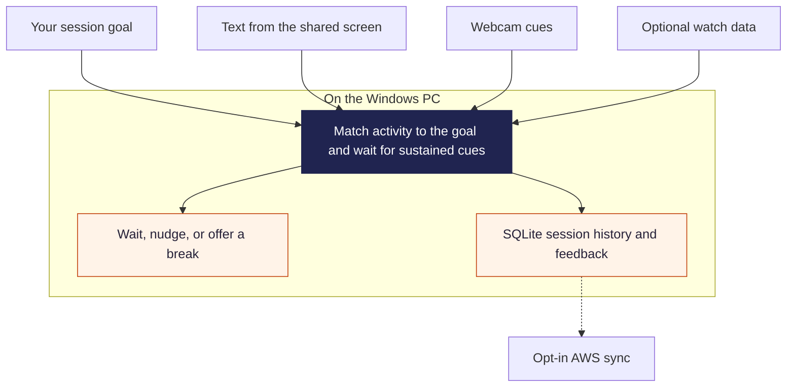

# PomoNoBro | Focus with Context

**Team WeKnowWhatWereDong · wHACKiest 2026 · Track 3 — Know Thyself**

## Offline Windows prototype

Extract the prototype ZIP and double-click **PomoNoBro.exe**. Keep the `Showcase` folder beside the EXE to load the two sample scenarios.

- **Focus** takes a goal and editable focus and break lengths. Start, pause, resume or end a session. When a focus session ends, you can start a break.
- **Showcase** replays activities from local JSON. Each step advances a simulated clock and evaluates the goal match and timing rules. Try **Dismiss**, **Snooze** or **I was on task** when a cue appears.
- **History** shows actual elapsed focus time. The app saves timer lengths and logged focus sessions to `%LOCALAPPDATA%\PomoNoBro\state.json`. Showcase runs stay in memory.

The app runs offline with text cues in Showcase. It uses regular Windows controls and .NET Framework 4.8 or later. The executable is unsigned.

## Two-minute showcase

1. In **Focus**, enter a goal and change the focus length. Start, pause and resume the timer, then end the session. Open **History** to see the time that was logged.
2. In **Showcase**, select **Discrete maths study block**. Run the steps. The lecture and notes match the goal. The 10-second interruption passes quietly. The two gaming steps add up to 45 seconds and trigger one refocus cue. The last step offers a break after the sample reports tiredness.
3. Select **Outline a lab report** and run two steps. Choose **I was on task** when the worksheet activity gets a cue. Run the next step to see the same activity accepted for the rest of the replay.
4. Change `offTaskSeconds` from 40 to 60 in a copy of the discrete maths file. Open it with **Open JSON…** and run through the gaming steps again. The 45-second stretch now stays below the threshold.

### Edit a scenario

Copy one of the supplied JSON files. Set `title`, `goal` and `steps`. Each step takes an `activity` description, a `kind` of `activity`, `away` or `tired`, and an integer `seconds` from 1 to 3600. Optional `focusTerms` are words or phrases matched against activity descriptions. The matcher uses words from the goal when terms are omitted. The optional `rules` object controls the four thresholds in seconds.

### Build from source

Run `powershell -NoProfile -ExecutionPolicy Bypass -File .\Build.ps1` from the source folder. The script uses the Windows .NET Framework compiler and writes the executable and samples to `dist`.

## Original ideathon proposal

PomoNoBro is a proposed Windows focus timer that uses your session goal to decide when a nudge would help. It keeps apps available so you can move between a lecture, notes and other resources during the same session.

### One 25-minute study session

**Goal** · Study discrete mathematics on YouTube and take notes.

| What happens | How PomoNoBro responds |
| --- | --- |
| You move from the lecture to your notes. | The timer keeps running quietly. |
| You step away for 10 seconds. | It gives you time to come back. |
| You watch a gaming video for 45 seconds. | An ElevenLabs cue asks, “Back to your maths lecture?” |
| Webcam cues suggest drowsiness and recent watch data adds context. | It offers a short break. |

You can snooze a cue or mark **I was on task**. That feedback helps the timer adjust future nudges.

### What drives the decision

The PC processes and discards screen and webcam frames. Watch readings stay on your devices. Optional AWS sync carries session summaries and cue feedback.

### 24-hour MVP

> [!NOTE]
> **Ideathon proposal.** The demo uses live screen and webcam inputs with clearly labeled sample watch data.

- **Build:** Electron and React for the Windows timer. Use local OCR and text matching for screen context, MediaPipe for webcam cues, and cached ElevenLabs audio for offline playback.
- **Verify:** The relevant lecture and brief interruption should pass quietly. A sustained off-task switch should trigger one cue. Track time back on task and user-marked unwanted nudges.
- **Extend:** Connect compatible watches through an Android Health Connect bridge. Add opt-in summary sync with AWS Lambda and DynamoDB.

### Free and paid

| Free | Paid · ₹99/month proposed |
| --- | --- |
| Goal-based timer, voice nudges, and local session history | Everything in Free, plus long-term focus trends and opt-in cross-device backup |

We’ll start with college students who study on Windows and recruit through class groups and student clubs.
