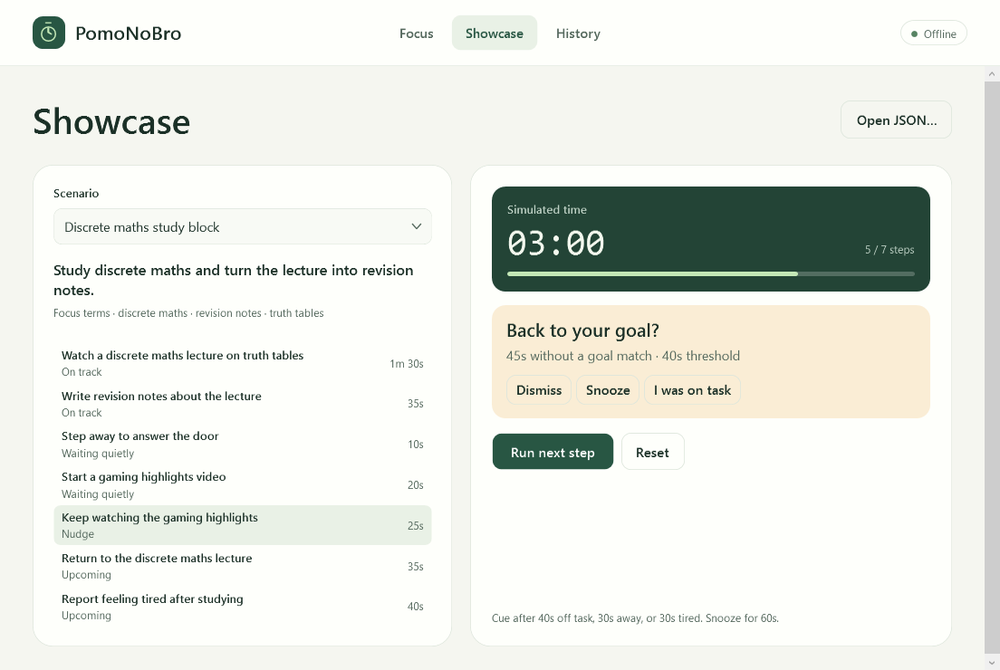

# PomoNoBro | Focus with Context

**Team WeKnowWhatWereDong · wHACKiest 2026 · Track 3 — Know Thyself**

The same browser tab can hold a lecture and a distraction. **PomoNoBro** is a Windows focus timer built around what you set out to do. Start with a goal, keep the apps you need open, and explore when a gentle nudge could help.

The prototype pairs a real focus and break timer with an interactive **Showcase**. Showcase replays sample activities on a simulated clock. The app runs offline and stores actual focus sessions on your PC.

## Try the showcase

In the app, open **Showcase → Discrete maths study block** and click **Run next step**. The goal is to study discrete maths and turn the lecture into revision notes.

| Sample activity | What you’ll see |
| --- | --- |
| Watch the lecture and write notes | Both activities match the goal. |
| Step away for 10 seconds | The app waits quietly. |
| Watch gaming highlights for 45 seconds | One nudge asks “Back to your goal?” |
| Report feeling tired after studying | The app offers a short break. |



Want to see the effect of feedback? In **Outline a lab report**, mark the worksheet activity **I was on task** when the nudge appears. Run the next step and the same activity counts as on task for the rest of the replay.

## Run on Windows

Use **Code → Download ZIP** on GitHub or clone this repository. On Windows with .NET Framework 4.8 or later, open PowerShell in the source folder and run the build script.

```powershell
powershell -NoProfile -ExecutionPolicy Bypass -File .\Build.ps1
```

Open **`dist\PomoNoBro.exe`**. Keep the `Showcase` folder beside the executable so it can find the sample scenarios. The executable is unsigned.

To use it as a timer, open **Focus**, enter a goal, and set your focus and break lengths. **History** shows the time you log when you end or finish a focus session.

## How the prototype works

The Showcase matches activity descriptions against focus terms and waits for a configurable duration before showing a cue. You can dismiss a cue, snooze it, or correct a mistaken match. The replay and its feedback stay in memory.

The [sample scenarios](Showcase/) are editable JSON. For example, change `offTaskSeconds` from 40 to 60 in a copy of the [discrete maths scenario](Showcase/01-discrete-maths.json). Load it with **Open JSON…** and replay the same 45 seconds of gaming activity. The app waits quietly because the new threshold hasn’t been reached.

## What we’d test next

The ideathon proposal explores opt-in screen, webcam, and wearable inputs for live cues, plus optional voice prompts and cloud backup. In a student pilot, we’d measure how quickly people return to their goal and which nudges they mark as unwanted. The proposed free tier covers the core focus timer, with longer-term trends and opt-in backup as a possible paid plan.
